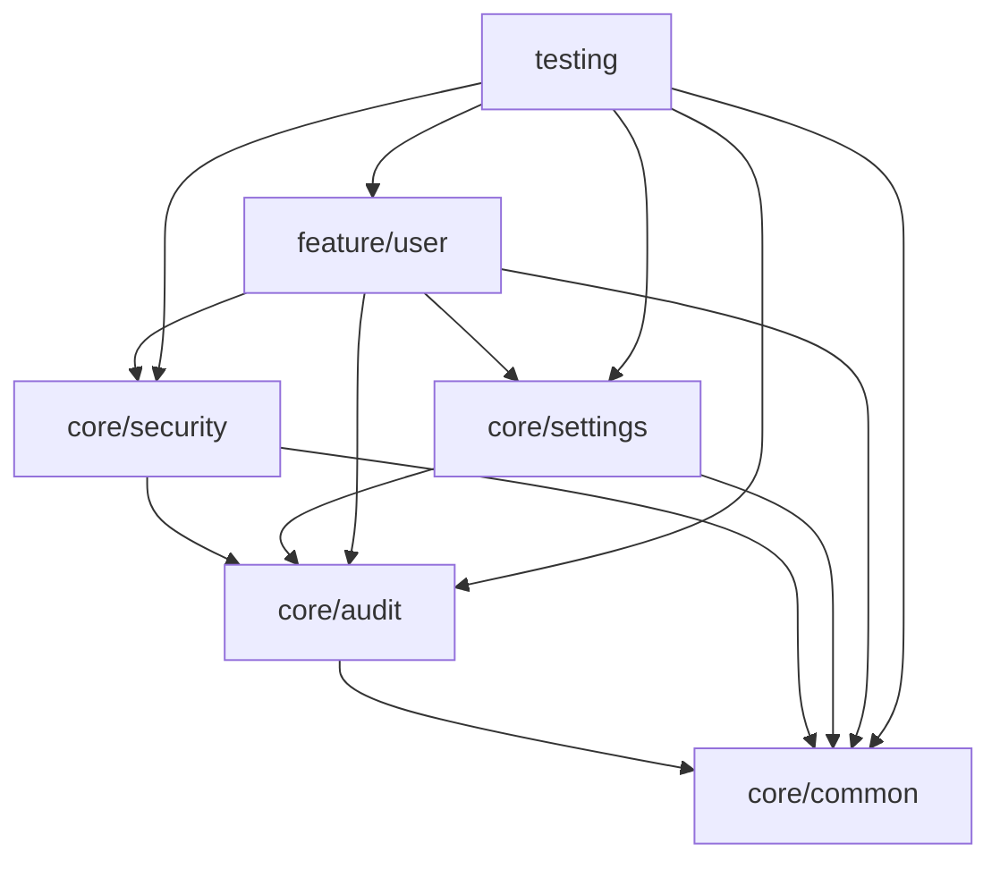
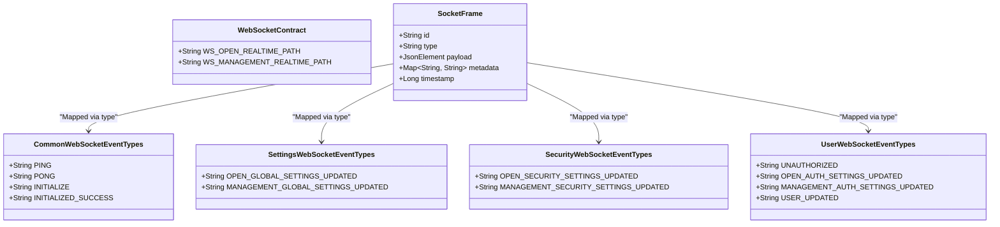
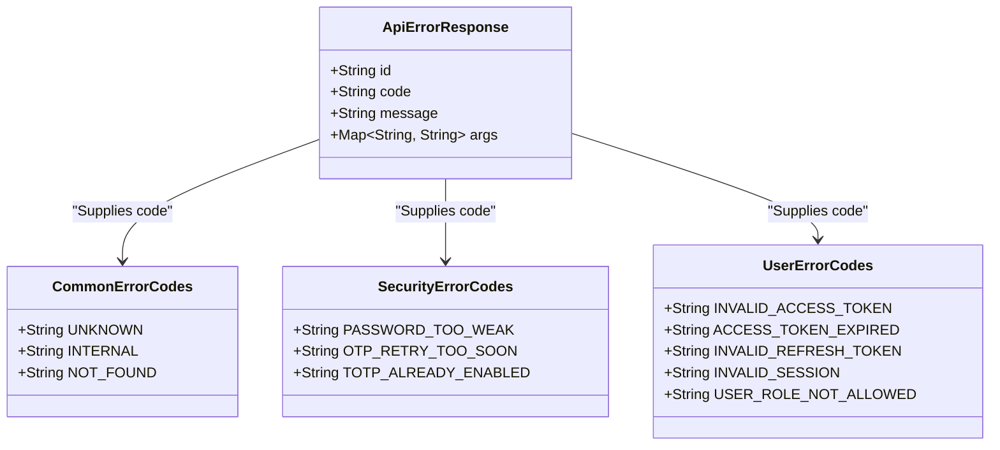
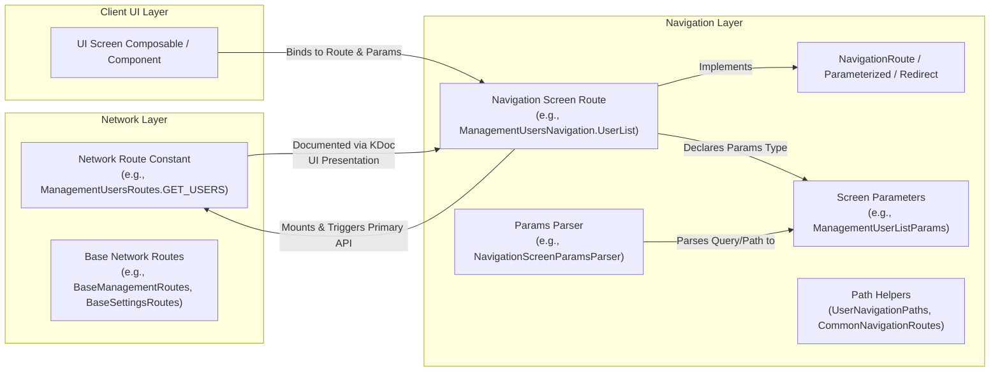

# shared-foundation Architecture

This document provides a visual representation of the static structure, taxonomy of contracts, and module dependencies within the `shared-foundation` project. As a shared contracts library containing wire types (DTOs, constants, error codes, Zod schemas, and routes), it does not include execution flows or engine wiring.

## 1. Module Dependency Graph

The following graph illustrates the static dependencies between the library modules, demonstrating the direction from `feature/*` to `core/*`.



## 2. Surface Separation: Open, Self-Management, and Management

This flowchart visualizes the architectural separation between unprivileged (Open), authenticated self-service (Self-Management), and protected admin (Management) API surfaces. It maps management routes to their corresponding, strongly-typed permission codes.

```mermaid
flowchart TB
    subgraph APISurfaces ["API Surfaces"]
        OpenAPI["Open API (Public / Unprivileged)"]
        SelfManagementAPI["Self-Management API (Authenticated Self-Service)"]
        ManagementAPI["Management API (Protected / Admin)"]
    end

    subgraph OpenRoutes ["Open Routes"]
        OpenGlobalSettingsRoutes["OpenGlobalSettingsRoutes"]
        OpenSecuritySettingsRoutes["OpenSecuritySettingsRoutes"]
        OpenUserRoutes["OpenUserRoutes"]
        OpenSessionRoutes["OpenSessionRoutes (open.user.session)"]
        OpenUnlockRoutes["OpenUnlockRoutes"]
        OpenIdentifierRoutes["OpenIdentifierRoutes (open.user.identifier)"]
        OpenAuthSettingsRoutes["OpenAuthSettingsRoutes"]
    end

    subgraph SelfManagementRoutes ["Self-Management Routes"]
        SelfManagementUserRoutes["SelfManagementUserRoutes"]
        SelfManagementSessionRoutes["SelfManagementSessionRoutes"]
        SelfManagementIdentifierRoutes["SelfManagementIdentifierRoutes"]
        SelfManagementUserSecurityRoutes["SelfManagementUserSecurityRoutes"]
        SelfManagementLoginRoutes["SelfManagementLoginRoutes"]
        SelfManagementUnlockRoutes["SelfManagementUnlockRoutes"]
        SelfManagementResetPasswordRoutes["SelfManagementResetPasswordRoutes"]
    end

    subgraph ManagementRoutes ["Management Routes"]
        ManagementGlobalSettingsRoutes["ManagementGlobalSettingsRoutes"]
        ManagementSecuritySettingsRoutes["ManagementSecuritySettingsRoutes"]
        ManagementAuditRoutes["ManagementAuditRoutes"]
        ManagementUsersRoutes["ManagementUsersRoutes"]
        ManagementSessionsRoutes["ManagementSessionsRoutes"]
        ManagementIdentifiersRoutes["ManagementIdentifiersRoutes"]
        ManagementUsersSecurityRoutes["ManagementUsersSecurityRoutes"]
    end

    subgraph PermissionCodes ["Permission Codes"]
        SettingsPermissionCode["SettingsPermissionCode"]
        SecurityPermissionCode["SecurityPermissionCode"]
        AuditPermissionCode["AuditPermissionCode"]
        UserPermissionCode["UserPermissionCode"]
        SessionPermissionCode["SessionPermissionCode"]
        IdentifierPermissionCode["IdentifierPermissionCode"]
        PermissionCode["PermissionCode (Base Inline Class)"]
    end

    OpenAPI --> OpenRoutes
    SelfManagementAPI --> SelfManagementRoutes
    ManagementAPI --> ManagementRoutes

    OpenRoutes -.-> OpenGlobalSettingsRoutes
    OpenRoutes -.-> OpenSecuritySettingsRoutes
    OpenRoutes -.-> OpenUserRoutes
    OpenRoutes -.-> OpenSessionRoutes
    OpenRoutes -.-> OpenUnlockRoutes
    OpenRoutes -.-> OpenIdentifierRoutes
    OpenRoutes -.-> OpenAuthSettingsRoutes

    SelfManagementRoutes -.-> SelfManagementUserRoutes
    SelfManagementRoutes -.-> SelfManagementSessionRoutes
    SelfManagementRoutes -.-> SelfManagementIdentifierRoutes
    SelfManagementRoutes -.-> SelfManagementUserSecurityRoutes
    SelfManagementRoutes -.-> SelfManagementLoginRoutes
    SelfManagementRoutes -.-> SelfManagementUnlockRoutes
    SelfManagementRoutes -.-> SelfManagementResetPasswordRoutes

    ManagementRoutes -.-> ManagementGlobalSettingsRoutes
    ManagementRoutes -.-> ManagementSecuritySettingsRoutes
    ManagementRoutes -.-> ManagementAuditRoutes
    ManagementRoutes -.-> ManagementUsersRoutes
    ManagementRoutes -.-> ManagementSessionsRoutes
    ManagementRoutes -.-> ManagementIdentifiersRoutes
    ManagementRoutes -.-> ManagementUsersSecurityRoutes

    ManagementGlobalSettingsRoutes -->|Enforced By| SettingsPermissionCode
    ManagementSecuritySettingsRoutes -->|Enforced By| SecurityPermissionCode
    ManagementAuditRoutes -->|Enforced By| AuditPermissionCode
    ManagementUsersRoutes -->|Enforced By| UserPermissionCode
    ManagementSessionsRoutes -->|Enforced By| SessionPermissionCode
    ManagementIdentifiersRoutes -->|Enforced By| IdentifierPermissionCode

    SettingsPermissionCode -->|Wraps| PermissionCode
    SecurityPermissionCode -->|Wraps| PermissionCode
    AuditPermissionCode -->|Wraps| PermissionCode
    UserPermissionCode -->|Wraps| PermissionCode
    SessionPermissionCode -->|Wraps| PermissionCode
    IdentifierPermissionCode -->|Wraps| PermissionCode
```



## 3. WebSocket Wire Contract

This diagram details the real-time communication envelope (`SocketFrame`) and categorizes the different feature event types flowing through the connection (`WebSocketContract`).



## 4. Taxonomy of Error Handling

This class diagram illustrates the unified shape of HTTP error bodies (`ApiErrorResponse`) alongside the categorized registry of standard and module-specific error codes.



## 5. Navigation Architecture & UI Presentation Traceability

This diagram illustrates how Network Routes, Navigation Screen Routes, and Navigation Screen Parameter Parsers link together to form a type-safe bridge between network endpoints and client UI screens.



### Core Navigation Contracts & Helper Index

#### 1. Core Navigation Contracts (`core/common`)
- **`NavigationRoute`**: Common base interface for all strongly-typed screen destinations (`route: String`, `parentRoute: String?`).
- **`ParameterizedNavigationRoute<P : NavigationScreenParams<*>>`**: Contract for navigation destinations carrying strongly-typed parameters (`params: P`).
- **`RedirectNavigationRoute`**: Contract for virtual/alias destination endpoints that delegate and redirect navigation to a target route (`targetRoute: String`) without rendering a standalone UI screen.
- **`NavigationScreenParams`**: Marker interface for typed screen parameter data classes.
- **`NavigationScreenParamsParser<T>`**: Contract for bidirectional parameter serialization (`parse(params: Map<String, Any?>): T` and `serialize(params: T): Map<String, List<String>>`).
- **`NavigationRouteUrlMapper`**: Utility object for formatting path strings, appending query maps, and building parameterized URLs.
- **`CommonNavigationRoutes`**: Common base navigation route path segments shared across platforms (`BASE_SETTINGS_ROUTE = "/settings"`).

#### 2. Base Network Routes & Navigation Paths
- **`BaseManagementRoutes`** (`core/common`): Base network route segments for management operations (`BASE_MANAGEMENT_ROUTE = "/management"`, `BASE_SELF_MANAGEMENT_ROUTE = "/management/self"`).
- **`BaseSettingsRoutes`** (`core/common`): Base network route segment for settings endpoints (`BASE_SETTINGS_ROUTE = "/settings"`).
- **`UserNavigationRoutes`** (`feature/user`): Base navigation route segment for user feature screens (`BASE_AUTH_ROUTE = "/auth"`).
- **`UserNavigationPaths`** (`feature/user`): Naming conventions for user navigation query parameters (`ACTION`, `REDIRECT_URL`, `TOTP_STEP`, `UNLOCK_METHOD`, `LOGIN_BY_TOTP_MODE`).

### Complete Navigation Classes Index

The library provides 11 strongly-typed navigation objects across two main hierarchies (Client and Management):

#### 1. Core Navigation Roots (`core/common`)
- **`ClientMainNavigation`**: Root navigation entry point for Client applications (`ROUTE = "/"`).
- **`ManagementMainNavigation`**: Root navigation entry point for Management/Admin applications (`ROUTE = "/management"`).

#### 2. Client Application Navigation (`feature/user`)
- **`ClientAuthNavigation`**: Unauthenticated authentication and onboarding screens (Login by Email/Phone/TOTP, Registration, Reset Password, Account Pending Deletion, and Unlock flows).
- **`ClientUserNavigation`**: Authenticated client user screens (Main User, Self Session List & Details, Self Identifier List & Details, TOTP Setup & Management).

#### 3. Management Application Navigation (`core/*` & `feature/user`)
- **`ManagementAuthNavigation`**: Admin authentication screens (Login by Email/TOTP, Reset Password, Unlock flows).
- **`ManagementAuthSettingsNavigation`**: Management authentication provider and email restriction configuration screen.
- **`ManagementSelfUserNavigation`**: Authenticated admin user self-service screens (User Main, Self Sessions, Self Identifiers, TOTP).
- **`ManagementUsersNavigation`**: Admin user management screens (User List & Detail, Global & User-Specific Session Lists, Global & User-Specific Identifier Lists).
- **`ManagementAuditNavigation`** (`core/audit`): System audit event listing (`AuditEventList`) and detailed view (`AuditEventDetail`).
- **`ManagementSecurityNavigation`** (`core/security`): Password policies, lockout rules, rate limits, and IP restriction settings (`SecuritySettings`).
- **`ManagementSettingsNavigation`** (`core/settings`): System-wide global settings and version requirements (`GlobalSettings`).

## 6. Localization Architecture & Resolution Flow

This diagram illustrates the compile-time code generation and runtime resolution flow for localized strings across all multiplatform targets.

```mermaid
flowchart TD
    subgraph BuildTime ["Compile-Time (GenerateLocalizationTask)"]
        JsonFiles["JSON Bundles\n(resources/localization/*)"]
        GradleTask["GenerateLocalizationTask"]
        BundleClasses["Generated *Strings.kt & *ModuleStrings.kt"]
        EmbeddedResources["Generated <ModulePrefix>EmbeddedLocalizationResources"]
    end

    subgraph Runtime ["Runtime Resolution"]
        Registry["LocalizationRegistry\n(O(1) Map by Module)"]
        Resolver["DefaultLocalizedStringResolver\n(Concurrent Map Caching & BCP 47 Fallback)"]
        ConsumerCall["Client Call\n(e.g., userStrings.ui.login)"]
        CustomLoader["Optional Custom resourceLoader\n(Partial Key Overrides)"]
    end

    JsonFiles -->|Scanned by| GradleTask
    GradleTask -->|Generates| BundleClasses
    GradleTask -->|Embeds String Maps into| EmbeddedResources
    BundleClasses -->|Auto-Registers in init| Registry
    ConsumerCall -->|Queries| BundleClasses
    BundleClasses -->|Delegates to| Resolver
    Resolver -->|Checks Custom| CustomLoader
    Resolver -->|O(1) Module Lookup| Registry
    Registry -->|Fetches Embedded Strings| EmbeddedResources
```

### Core Localization Contracts & Helper Index

- **`LocalizedStringResolver`**: Functional interface `resolve(module, file, key, locale): String?` implemented by resolvers.
- **`LocalizationBundleProvider`**: Functional interface `get(module, file, locale): Map<String, String>?` supplying module string maps.
- **`LocalizationRegistry`**: Thread-safe registry (`LocalizationRegistry.register(module, provider)`) maintaining module embedded resources with O(1) map lookup.
- **`DefaultLocalizedStringResolver`**: Out-of-the-box thread-safe resolver with in-memory caching and BCP 47 fallback chain (`locale -> language -> CommonLocales.DEFAULT`). Resolves from `LocalizationRegistry` and supports partial key overrides via optional `resourceLoader`.
- **`CommonLocales`**: Standard BCP 47 locale constants (`ENGLISH = "en"`, `RUSSIAN = "ru"`, `DEFAULT = "en"`).


