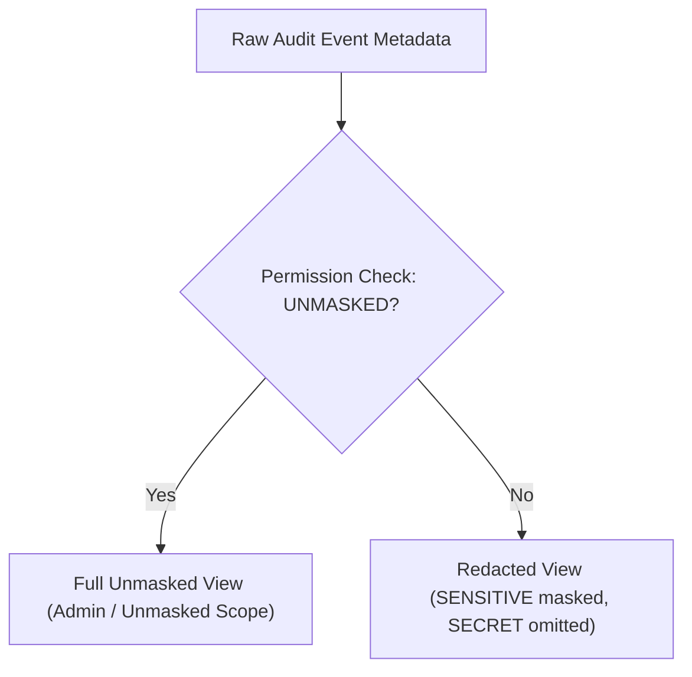

# Audit Logging & Redaction Contracts

This document defines the structured audit event taxonomy, actor scopes, dynamic authorization filters, and sensitive data redaction tiers defined in `core/audit`.

---

## 1. Audit Event Structure

Every audit event captures a structured immutable record of platform activity:
- **`AuditEventId`**: Branded UUID identifier.
- **`actor`**: Actor snapshot (`AuditActorType`: `USER`, `STAFF`, `ADMIN`, `SYSTEM`, `SERVICE`).
- **`action`**: Action discriminator string (e.g. `user.login`, `password.change`, `storage.file_upload`).
- **`resource`**: Resource kind (`CommonAuditResourceType`, `UserAuditResourceType`, `StorageAuditResourceType`).
- **`status`**: Outcome (`AuditStatus`: `SUCCESS`, `FAILURE`, `DENIED`).
- **`metadata`**: Structured key-value metadata array with sensitivity hints (`AuditValueSensitivity`).

---

## 2. Dynamic Authorization Filters (`AuditAccessFilter`)

Access to audit query endpoints (`ManagementAuditRoutes`) is governed by Role-Based Access Control (RBAC):
- **`AuditAccessFilter`**: Dynamically scopes queries based on caller `UserRole` and granted `AuditPermissionCode`.
- **`STAFF`**: Can inspect audit events generated by standard `USER` actors.
- **`ADMIN`**: Can query system-wide administrative audit trails across all actor types.

---

## 3. Value Sensitivity & Redaction Tiers (`AuditValueSensitivity`)

Metadata entries carry a sensitivity classification to govern masking in API responses:
- **`NONE`**: Public metadata (e.g. non-sensitive filter parameters).
- **`SENSITIVE`**: Partially masked for standard staff (e.g. IP address masked as `192.168.x.x`, email masked as `u***@example.com`).
- **`SECRET`**: Fully redacted in standard audit views; visible only with unmasked audit permissions (e.g. `AUDIT_GET_FOR_USER_ACTOR_UNMASKED`).

---

## 4. Projection Tiers Taxonomy

- **`AuditEventSummary`**: Compact record for audit log lists (id, action, actorType, status, timestamp).
- **`AuditEventPrivate`**: Detailed view including client info, resource details, and masked/unmasked metadata array.
- **`AuditEventInternal`**: Internal backend entity including raw unredacted payload.
