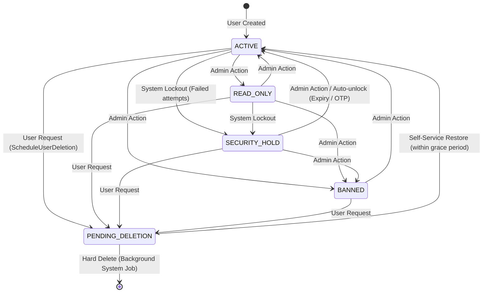

# Identity & Access Domain Contracts

This document defines the core contract structures, projection tiers, and state machines governing Identity, Authentication, and Authorization within `shared-foundation`.

---

## 1. User Roles (`UserRole`)

Roles define the broad tier of access a user possesses:
- **`USER`**: Regular end-user accessing client applications.
- **`STAFF`**: Employee/moderator role intended for operational work, granted specific domain permissions.
- **`ADMIN`**: Superuser with complete system access, audit logs, and global user management.

---

## 2. Permissions (`PermissionCode`)

While roles define broad tiers, the system uses granular permissions for precise access control, primarily for `STAFF` and `ADMIN` users on Management APIs:
- Permissions are strictly typed using domain permission objects (`UserPermissionCode`, `SecurityPermissionCode`, `AuditPermissionCode`, `StoragePermissionCode`).
- Request handlers and gateway interceptors check these codes before executing privileged operations.

---

## 3. Account Statuses (`UserAccountStatus`)

The status of an account overrides its role and determines if the user can authenticate or perform actions:
- **`ACTIVE`**: Fully functional account.
- **`READ_ONLY`**: The user can view data but cannot mutate state (used as a disciplinary or administrative action).
- **`BANNED`**: Complete restriction from the system.
- **`SECURITY_HOLD`**: Automatically applied by the system when suspicious activity or brute-force attacks are detected.
- **`PENDING_DELETION`**: The user has requested account deletion. The account enters a grace period before permanent hard deletion.

### Account Status State Machine

---

## 4. User Identifiers (`UserIdentifier`)

An identifier represents a login method linked to a core `UserId`:
- **Providers (`UserAuthProvider`)**: `EMAIL`, `PHONE`, `GOOGLE`, `APPLE`, etc.
- **One-to-Many**: A single user can have multiple linked identifiers (e.g. an email address and a linked Google account).
- **Constraints**: Uniqueness is strictly enforced per `(provider, identifier)` pair.
- **Projections Taxonomy**:
  - `UserIdentifierSummary`: Public list view (masked value, provider type).
  - `UserIdentifierPrivate`: Private self/admin view (full value, verified status, createdAt).
  - `UserIdentifierInternal`: Internal entity storing credentials or OAuth subject IDs.

---

## 5. User Sessions & Device Metadata

Represents an active, authenticated login on a specific device:
- **Tokens**: Associated with a short-lived `AccessToken` (JWT) and a long-lived `RefreshToken` (persisted as cryptographic hash `RefreshTokenHash`).
- **Device Metadata (`ClientDeviceInfo`)**: Tracks IP address, User-Agent, OS, client type (`ClientType`), and device ID (`ClientDeviceId`).
- **MFA Step-Up (`lastReauthenticatedAt`)**: Crucial for sensitive security actions (changing password, deleting account). Forced step-up re-authentication occurs if `lastReauthenticatedAt` exceeds the configured validity window.
- **Projections Taxonomy**:
  - `UserSessionSummary`: Condensed list view (device name, OS, lastAccessedAt).
  - `UserSessionPrivate`: Detailed view (IP, full client info, token expiration).
  - `UserSessionInternal`: Internal domain logic representation.
