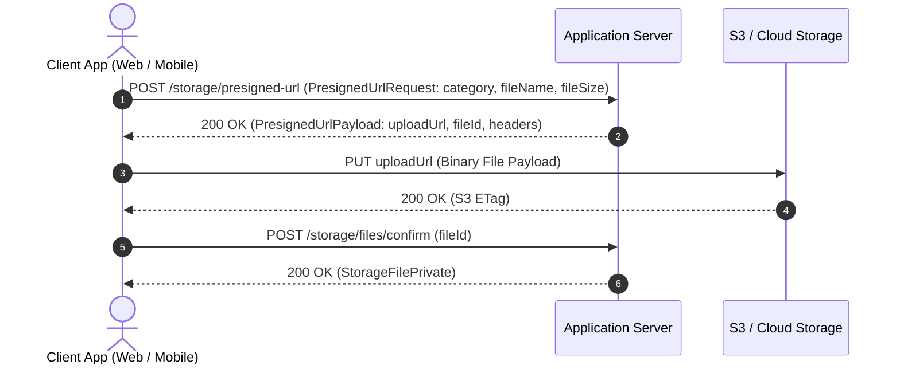

# Storage & Presigned Upload Contracts

This document defines storage file projections, direct-to-S3 upload workflows, and access categories defined in `core/storage`.

---

## 1. Storage Categories (`StorageCategory`)

Storage categories govern dynamic file size limits, allowed MIME types, and retention rules:
- **`AVATAR`**: Profile images (JPEG, PNG, WebP).
- **`ATTACHMENT`**: Document/file attachments for user communication or tickets.
- **`EXPORT`**: Generated CSV/PDF data exports.
- **`SYSTEM_RESOURCE`**: Static platform assets managed by administrators.

---

## 2. File Status & Visibilities

### File Status (`StorageFileStatus`)
- **`PENDING_UPLOAD`**: Presigned URL generated; waiting for client upload to Object Storage.
- **`ACTIVE`**: Upload confirmed and validated by server; available for access.
- **`DELETED`**: Soft-deleted record.
- **`FAILED_PROCESSING`**: Upload failed or virus scan rejected the file.

### File Visibility (`StorageFileVisibility`)
- **`PUBLIC`**: Publicly readable file via CDN.
- **`PRIVATE`**: Restricted to owner user or privileged staff.
- **`INTERNAL_ONLY`**: Internal system processing file.

---

## 3. Direct-to-S3 Presigned Upload Workflow

To offload file transfer overhead from application servers, clients upload files directly to Object Storage (S3):

---

## 4. Image Preset Resolution (`urlPresets`)

For image uploads, server dynamically computes signed URL variants (e.g. `avatar_sm`, `thumbnail`, `preview`), returned alongside `originalUrl` in `StorageFilePrivate`.

---

## 5. Entity Projections Taxonomy

- **`StorageFileSummary`**: Compact representation for lists and cards (id, fileName, fileSize, category, status).
- **`StorageFilePrivate`**: Complete owner/admin view including S3 key, presigned read URL, `urlPresets`, and detailed metadata.
- **`StorageFileInternal`**: Internal domain entity including storage provider details.
